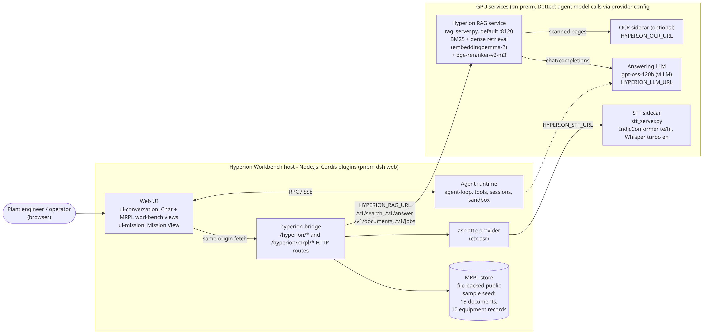
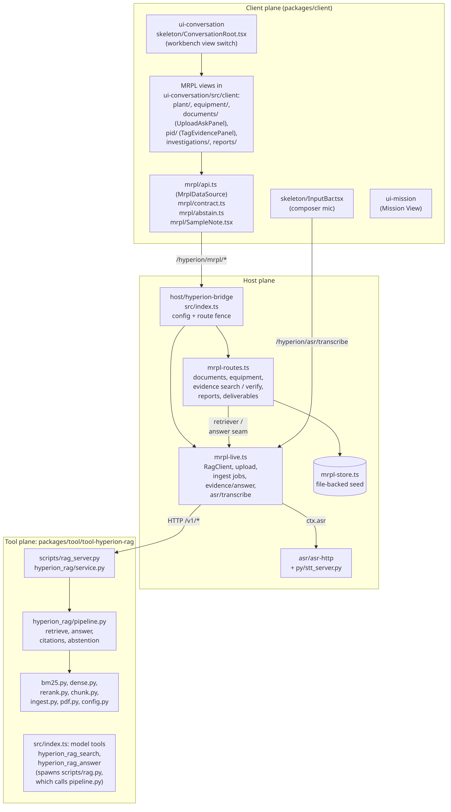
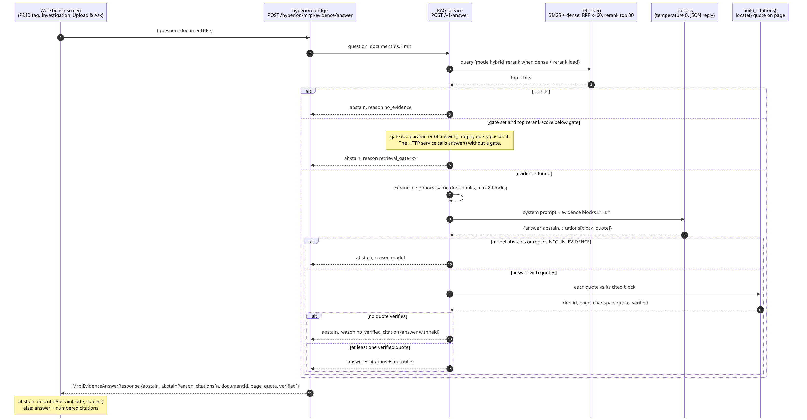
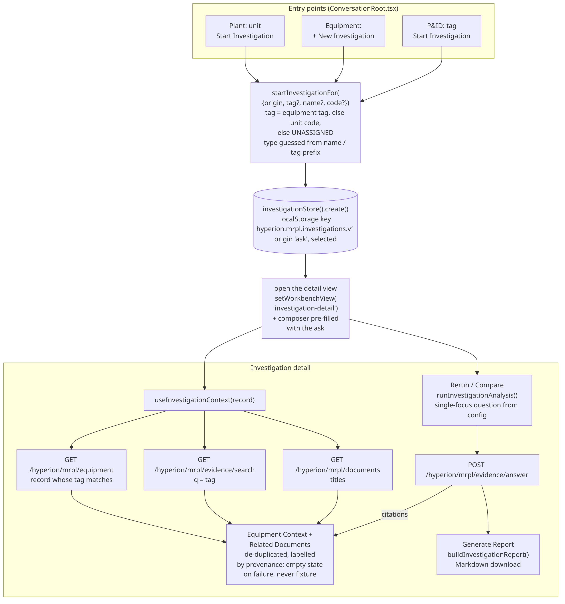

# Hyperion Workbench — Approach

This document explains *why* the MRPL workbench and its RAG wiring are built the way they are. It describes the code on `feat/mrpl-wire-integration` (draft PR #27, head `fef63ee8`); file paths are relative to the repository root. For setup and commands see the [README](README.md).

---

## 1. Problem

Refinery engineers answer questions from a large, mixed document set: incident case studies, standards, specification sheets, equipment records, P&IDs, scanned pages. Three constraints shape the solution:

1. **The documents and the models stay on-premise.** The answering model is an OpenAI-compatible endpoint the deployment controls (`HYPERION_LLM_URL`, default `http://127.0.0.1:8001/v1`); retrieval, reranking, OCR and speech run as local services.
2. **A wrong number is worse than no answer.** A guessed limit, tag or part number can be acted on. The answer prompt in `pipeline.py` says it plainly: *"Answer ONLY from the evidence blocks … never guess part numbers, values, dates or names."*
3. **Every claim must be traceable** to a document, a page and the exact text, so an engineer can check it in seconds.

The pilot also has a data problem: real MRPL plant records were not available, so the workbench runs on a **public sample corpus** (13 documents, 10 equipment records in `packages/host/hyperion-bridge/mrpl-seed/`) and must never present that as plant data.

## 2. Design choices and why

### 2.1 Reuse a plugin runtime instead of building one

Hyperion is a fork of DeepSeek Harness on the Cordis plugin framework. Models, tools, sessions, sandbox, the web server and the UI views are plugins composed from `cordis.yml`. The MRPL work adds plugins (`hyperion-bridge`, `tool-hyperion-rag`, `asr-http`) and client views rather than modifying the runtime, so the generic product on `master` and the MRPL customisation can evolve separately.

### 2.2 RAG as a separate Python service behind a typed bridge

- **Python service** (`packages/tool/tool-hyperion-rag/scripts/hyperion_rag/`): the retrieval stack (EmbeddingGemma 2, a cross-encoder reranker, PDF/OCR handling) lives in the Python ML ecosystem. `service.py` keeps the index warm, ingests uploads in a background job queue, and exposes `/v1/search`, `/v1/answer`, `/v1/documents`, `/v1/jobs/<id>`.
- **Bridge** (`packages/host/hyperion-bridge`): the browser only calls same-origin `/hyperion/mrpl/*` routes. The bridge applies the composition's connection-rejection fence to every route, bounds request bodies, and owns the RAG URL and timeout (`HYPERION_RAG_URL`, `HYPERION_RAG_TIMEOUT_MS`). The RAG service never has to be exposed to browsers.
- **Typed contract**: route constants and response types live once in `hyperion-bridge/src/shared.ts` and are mirrored for the client in `ui-conversation/src/client/mrpl/contract.ts`; `tests/mrpl-contract.client.spec.tsx` guards the mirror.
- **One seam for the UI**: every screen reads through `MrplDataSource` (`mrpl/api.ts`). Production uses `createHttpMrplSource()`; tests inject a source with `<MrplSourceProvider>`. That is what lets the same components be unit-tested with fakes and e2e-tested against live services.

### 2.3 Hybrid retrieval tuned for tags

Industrial questions mix exact identifiers (`E-6600E`, `OISD-STD-105`) with paraphrase. The pipeline runs both:

- **BM25** (`bm25.py`, standard library) with a tokenizer that folds Unicode hyphens and indexes tag-like compounds both whole and as parts, so an exact tag query matches strongly without breaking prose matching.
- **Dense** retrieval with `google/embeddinggemma-2` (Matryoshka 768/512/256/128, `HYPERION_RAG_DIM`).
- **Reciprocal rank fusion** (`rrf()`, k = 60) over both lists (pool 100 each), then **`BAAI/bge-reranker-v2-m3`** rescoring the top 30 (`HYPERION_RAG_RERANK_TOP`).

`hybrid_rerank` is the default mode when dense and rerank load (`HYPERION_RAG_MODE`). The measured reason is in [docs/benchmarks/rag.md](docs/benchmarks/rag.md): on the synthetic 600-question set, `hybrid_rerank@768` reached 83.6 % accuracy against 82.8 % for BM25 alone and 61.2 % for dense alone, and the hybrid + reranker stack is what held up once document ids were removed from the questions.

### 2.4 Chunks that are exact slices

`chunk.py` makes every chunk a contiguous slice `page.text[char_start:char_end]` of one page. Section headings are carried forward and prepended to the *indexed* text, not to the span. So a citation (doc id + page + char span) always points at real page text, and the context the retrievers see is richer than the text that is cited.

### 2.5 Degrade loudly, never silently

- Without torch or the dense model the index is BM25-only, and every response carries the reason in `degraded`; the bridge forwards it and generated reports print `_Degraded: …_`.
- LLM connection errors and 5xx are retried with backoff for `HYPERION_LLM_MAX_WAIT_S` (900 s) and then raised as `LLMUnavailable` — an infrastructure failure, deliberately distinct from an abstention.
- Without `HYPERION_RAG_URL` the live bridge routes return `503 mrpl/rag-not-configured`, evidence search reports `retrieval: 'not-configured'`, and investigation analysis throws `AnalysisUnavailableError`. None of them fall back to fixture data.

### 2.6 Configuration over constants

Wording, limits and questions are configuration with documented defaults, overridable by hosts and tests:

- RAG service: `RagConfig.from_env()` in `config.py` is the only place model ids, endpoints, thresholds and paths are read.
- Client: `configureAbstain()` (`mrpl/abstain.ts`), `configureInvestigations()` (`investigations/config.ts`: storage key, analysis/compare questions, sample labels, context limits), `configurePlant()` (`plant/config.ts`).

### 2.7 Label sample data where it is shown

Where a panel still shows fixture data (Plant metrics and process units; investigation Key Findings, Vibration Trend, evidence list, Similar Equipment; the fixture pump when no record is open), it renders `SampleNote` (`mrpl/SampleNote.tsx`: `role="note"`, `data-sample-data`) with a label from config. Generated reports state *"Public / synthetic corpus — not an original MRPL record."* The goal is that nothing on screen can be mistaken for plant data.

### 2.8 Remove controls that cannot work

A static audit (`docs/mrpl/control-audit.md`) classified 224 MRPL controls as REAL / WIRED / LOCAL / DEAD and found 86 dead at `b3e55cf5`. The wire PRs either connected a control to a real action or removed it: for example the plant map's Satellite toggle was removed because there is no imagery source, Fullscreen and Open Unit are hidden when the host provides no handler, dead Notifications / profile buttons were removed from the shell, and 124 unused CSS rules were pruned from `ReportsOverview.module.css` with a spec that fails on dead selectors.

## 3. The RAG pipeline

**Ingest** (`ingest.py`, `pdf.py`, `service.py`). Accepted shapes: JSONL rows, Markdown/text directories, refinery `corpus/processed/*.json`, per-page directories, HTML captures. Uploads (PDF, Markdown, plain text) go through a job with stages; pages with fewer than `HYPERION_RAG_OCR_MIN_CHARS` (40) native characters are sent to the OCR sidecar when one is configured, otherwise reported as `ocr-pending`. `Index.add_documents()` chunks, BM25-appends and embeds only the new chunks; re-uploading a document id replaces it.

**Retrieve** (`retrieve()`). BM25 and dense lists → RRF → rerank → top k. When the caller restricts `documentIds`, the service over-fetches (`max(limit × 10, 50)`) and filters.

**Assemble evidence** (`expand_neighbors()`). Each hit pulls its adjacent same-document chunks (window 1, at most 8 blocks), ordered by document and position, because procedural answers often straddle a chunk boundary.

**Generate.** The model receives evidence blocks `[E1] … [En]` (doc, title, page, section) and must reply with one JSON object: `answer`, `abstain`, and `citations` as `{block, quote}` pairs, at temperature 0.

**Verify citations** (`build_citations()`, `locate()`). Each quote is located inside the cited block, in order: exact match; normalised match (markdown, Unicode hyphen and whitespace tolerant); ellipsis-split segments in order; then a token-window fuzzy match requiring ≥ 85 % of the quote's tokens inside a tight window **and every token containing a digit present** — so a quote with a wrong value never verifies. The shown quote is always the real page text at the located span. Each citation carries `doc_id`, 1-based `page`, `char_start`/`char_end`, `quote`, `quote_verified`, `href = <source>#page=N` and a footnote `[^n]: [DOC](href) p. N, chars a-b: "quote"`.

**Abstain** in layers (`answer()`):

| Layer | Code | Meaning |
|---|---|---|
| 1 | `no_evidence` | Retrieval returned nothing |
| 2 | `retrieval_gate<x>` | Top rerank score below the gate (optional; the HTTP service passes none) |
| 3 | `model` | The model set `abstain` or answered `NOT_IN_EVIDENCE` |
| 4 | `no_verified_citation` | The model answered, but no quote could be located; the answer is withheld |

**Report mode** (`answer_report()`, used by the `hyperion_rag_answer` tool with `report: true`). The model writes atomic claims, each with verbatim quotes, plus a list of `uncertainties`. Claims without a verified quote move to `dropped_claims`; if none survive, the result abstains (`model`, `no_verified_citation`, or `unparseable_model_output`). Partial answers are expected and gaps are listed rather than guessed.

**Bridge-side reports.** `POST /hyperion/mrpl/reports` turns a topic into a question (`reportQuestion()`), calls the answer route and writes Markdown with a numbered `## Sources` list marking each citation verified or unverified (`buildReportMarkdown()`).

## 4. Investigation flow

1. **Start** from Plant (unit), Equipment (+ New Investigation) or P&ID (tag). `ConversationRoot.tsx` calls `startInvestigationFor({origin, tag?, name?, code?})` (`investigations/investigation-actions.ts`).
2. **Create a real record.** The tag is the equipment tag, else the unit code, else the configured `UNASSIGNED`; the equipment type is guessed from the name or tag prefix; metadata records the originating surface. `investigationStore().create()` persists it in `localStorage` (`hyperion.mrpl.investigations.v1`) with origin `'ask'` and selects it.
3. **Open the detail view** and pre-fill the composer with the ask.
4. **Context from the record** (`useInvestigationContext`): the equipment record whose tag matches (case- and hyphen-insensitive) from `/hyperion/mrpl/equipment`, an evidence search for the tag, document titles from the catalog, and the citations of the investigation's own analysis — merged into one de-duplicated Related Documents list with provenance (*cited by equipment record / evidence search match / cited in analysis*). A missing route or a failure yields a labelled empty state, never the fixture pump.
5. **Analyse.** Rerun and Compare call `runInvestigationAnalysis()`, which asks a **single-focus** question from config. This was measured: the multi-part forms ("causes, limits and checks") made gpt-oss answer `NOT_IN_EVIDENCE` even for an asset the corpus covers (E-6600E), while the single-focus forms answer with verified citations (DOC-008 p.13 and p.38 in the live run).
6. **Report.** Generate Report builds Markdown with numbered citations (`buildInvestigationReport()`); an abstention is written as readable text, not a code.

## 5. Honest abstention

The system prefers saying *"not in the documents"* to producing something plausible. Concretely:

- The model may only use the evidence blocks; outside knowledge is forbidden by prompt.
- An answer whose quotes cannot be found on the cited page is **withheld**, even if it might be right.
- A quote is only marked verified if every number in it is present in the located page span.
- Abstention is a normal, first-class result with a reason, kept separate from infrastructure failure (`LLMUnavailable`, bench `infra_error`).
- The UI explains the reason in plain language. `describeAbstain(code, subject)` maps each code (and `retrieval_gate*` by prefix) to text with the tag or topic substituted, shows prose reasons as written, and falls back to a generic sentence for unknown codes. The raw code is kept only in a `data-abstain-reason` attribute for debugging. In the live P&ID run, a tag that exists only on the sample schematic (E-101) now reads *"No grounded answer. E-101 is not covered by the indexed documents. The closest passages do not answer it, so Hyperion did not guess."* instead of *"No grounded answer for E-101: model."*

## 6. Testing strategy

| Layer | What | Where |
|---|---|---|
| Client behaviour (TDD) | Each wiring change started with a failing spec, then the change: abstention text (9 tests), record-driven investigation context (6), Start Investigation (5), sample labels (4), plant map controls (4 new), reports, P&ID/plant wiring, documents facets, upload & ask | `packages/client/ui-conversation/tests/*.client.spec.tsx` |
| Contract | Client mirror of bridge route constants and types | `tests/mrpl-contract.client.spec.tsx` |
| Dead-code guards | Fails when a CSS class in `ReportsOverview.module.css` is unused | `tests/reports-css-unused.client.spec.ts` |
| Host | Bridge routes, report generation, live-route client against fakes | `packages/host/hyperion-bridge/tests/` |
| RAG core | Standard-library tests on the BM25 path with a fake LLM; live-ingest test | `tool-hyperion-rag/scripts/test_hyperion_rag.py`, `test_live_ingest.py` |
| STT | Sidecar, decoding, auto-detect relabelling, tag/number normalisation | `packages/asr/asr-http/py/test_*.py` |
| Live end-to-end | Real Chromium → MRPL harness → in-process bridge → live RAG + STT; nothing mocked; **skips, never passes,** when the live URLs are unset | `apps/web/tests/mrpl-wire-live.e2e.ts`, `mrpl-live.e2e.ts` |
| Benchmarks | Retrieval, answer accuracy, abstention precision/recall, citation verification on synthetic, OCR'd and refinery sets | `tool-hyperion-rag/bench/`, `docs/benchmarks/` |

Last recorded results on this branch: ui-conversation 49/49 files, 487/487 tests; host and client `tsc` clean; live suite 5/5.

The live suite caught two things unit tests could not: the multi-part investigation question that made the model abstain on a covered asset, and the raw `model` reason code reaching the screen.

## 7. Trade-offs

- **Investigations live in `localStorage`.** Records persist across reloads in one browser but are not shared between users or machines. Chosen to make Start Investigation real without designing a server-side store first.
- **Abstention over coverage.** Requiring a verified quote withholds some correct answers; on the synthetic benchmark, accuracy before the citation gate was a few points higher than after (87.8 % vs 83.6 % for `hybrid_rerank@768`). The pilot accepts that cost.
- **No retrieval gate on the HTTP path.** The gate sweep showed no effect up to 0.3 on the synthetic set because the model already abstains, so it stays off rather than adding a threshold that was never calibrated on refinery documents.
- **Single-focus questions** answer reliably but give narrower analyses than a multi-part brief would.
- **Public sample corpus.** It lets the full pipeline run end to end with real citations, but every fixture-backed panel has to be labelled, and some seeded items (P-204, E-101) honestly abstain.
- **Separate services** (RAG, LLM, OCR, STT) add deployment steps, but keep GPU-heavy components independently restartable and the browser isolated from them.
- **Commits with `--no-verify`.** The integration worktree lacked the hook toolchain; typecheck and lint were run separately instead.

## 8. What's next

Open items, taken from the integration notes and the code:

1. Map RAG reason codes to readable text in host-generated report Markdown (`buildReportMarkdown()` still prints the code).
2. Fix PR #23 so it no longer commits `node_modules` symlinks (this branch already untracks them).
3. Re-run the control audit against the current head and close the remaining dead controls.
4. Bring the oxlint baseline down and resolve the inconsistent whole-repo count seen in the droplet copy.
5. Wire or remove the `.env.example` variables no code reads; add the missing `docs/mrpl/configuration.md` the bridge refers to.
6. Mount an asr provider in a web profile so the composer mic works without a custom overlay.
7. Replace remaining fixtures (Plant metrics, investigation findings and trends) with record-driven data, and move investigations to a server-side store.
8. Calibrate a retrieval gate on the refinery corpus before enabling it.
9. Index real MRPL documents once available, and validate STT (including Telugu auto-detect) on real operator recordings.
10. Land a citation viewer that opens the cited PDF page (a remote branch `feature/citation-pdf-viewer` exists; it is not part of this branch).
